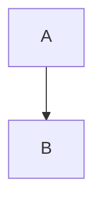

## Release maths

The rate is $`r = \frac{d}{t}`$, it costs $5, and `x`\$ is not an equation.

**$``  a `b`  ``$**

```math
E = mc^2
\int_0^1 x\,dx
```

```bash
make deploy
```



| Step | Cost |
| --- | --- |
| Build | $`O(n)`$ |
